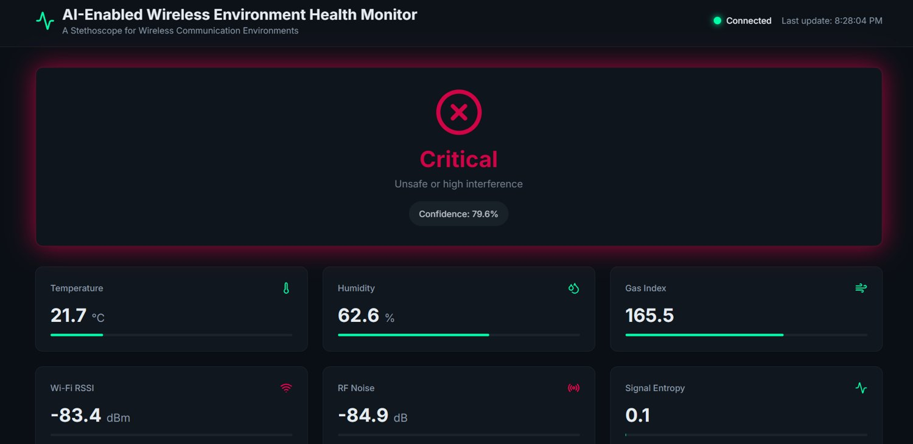
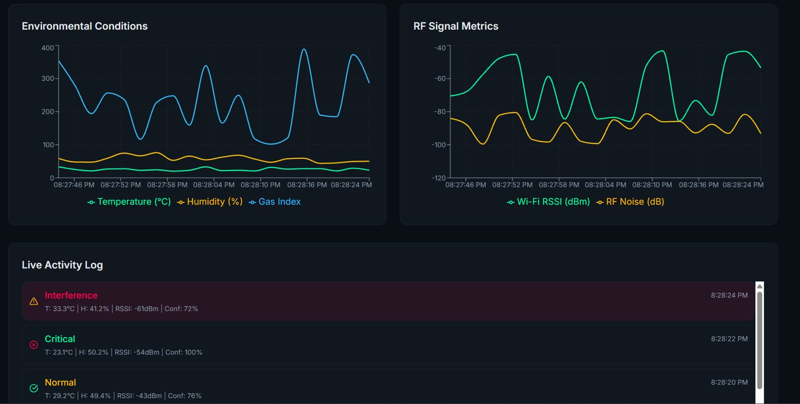
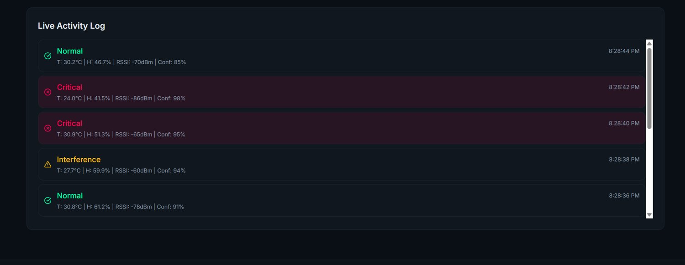

# AI-Enabled Wireless Environment Health Monitor

**A Stethoscope for Wireless Communication Environments**

An IoT- and RF-focused prototype that explores monitoring changes in a wireless environment and classifying observed patterns into normal, interference, and critical conditions. The project combines RF measurements, environmental sensor context, feature engineering, an AI/ML classification workflow, and a visual dashboard.

> **Prototype scope:** The college demonstration used a 433 MHz RF setup and synthetic test data. It demonstrates an RF-environment monitoring and classification workflow; it is not a validated cellular-call interception, cellular spoofing, or phone-tracking detector.

---

## Table of Contents

- [Overview](#overview)
- [Project Objectives](#project-objectives)
- [Prototype and Hardware Context](#prototype-and-hardware-context)
- [Feature Groups](#feature-groups)
- [How the Classification Workflow Works](#how-the-classification-workflow-works)
- [Dashboard](#dashboard)
- [Technology Stack](#technology-stack)
- [Run the Dashboard](#run-the-dashboard)
- [Synthetic Dataset and Testing](#synthetic-dataset-and-testing)
- [Repository Scope](#repository-scope)
- [Limitations and Future Improvements](#limitations-and-future-improvements)

---

## Overview

Wireless communication quality can change because of several factors: signal attenuation, obstacles, multipath fading, interference, changes in transmitter or receiver position, and other environmental conditions. Looking at one signal-strength reading in isolation is not enough to understand what is happening.

This project explores a multi-parameter monitoring approach. It considers:

1. **RF signal measurements** such as received signal strength and noise-related measurements.
2. **RF behaviour over time** such as sudden changes, variation, and entropy.
3. **Environmental context** such as temperature, humidity, and gas-sensor readings.

The classification workflow uses these feature groups together so that an environmental fluctuation is not automatically treated as an RF anomaly. The dashboard provides a visual view of the measurements, trends, predicted condition, and confidence score.

## Project Objectives

- Monitor a selected RF environment using a low-cost prototype.
- Observe signal-strength changes, noise-related measurements, and signal behaviour over time.
- Include environmental sensor readings as context when interpreting RF fluctuations.
- Explore classification of observations into **Normal**, **Interference**, and **Critical** conditions.
- Visualize measurements and classification results through a dashboard.
- Test different combinations of RF and environmental conditions using a designed synthetic dataset.

## Prototype and Hardware Context

The prototype was designed as a nearby, passive RF-environment monitor for a college demonstration. A **433 MHz** operating frequency was selected for the prototype setup.

Hardware considered in the project:

| Component | Role in the prototype |
|---|---|
| **RFM69HCW** | Sub-GHz RF transceiver used for measurements on its configured radio link, including RSSI-related observations. |
| **RTL-SDR** | Software-defined radio receiver for observing RF activity within the receiver's supported frequency range and configuration. |
| **Environmental sensors** | Provide temperature, humidity, and gas-related readings to add environmental context. |

The hardware components do not all measure the same thing. The RFM69HCW reports measurements for its configured radio channel, while an RTL-SDR provides sampled RF data for software analysis. The exact frequency coverage and measurable signals depend on the receiver, antenna, tuning, gain, and bandwidth configuration.

### Important distinction

The prototype's 433 MHz monitoring setup does **not** directly monitor a mobile phone's cellular call. Cellular communication uses operator- and technology-specific frequency bands, which are different from the 433 MHz demonstration band. Observing an RF anomaly is also not, by itself, proof of spoofing or tracking.

The project is therefore best understood as a prototype for **wireless-environment health monitoring and RF anomaly classification**, with spoofing/interference awareness as a motivating application area that would require further validation.

## Feature Groups

The feature design considers three groups of information.

### Group A — RF signal measurements

These features describe the measured signal or RF background:

| Feature | Purpose |
|---|---|
| `wifi_rssi` | Wi-Fi received signal-strength value, when available from the configured measurement source or test data. |
| `rfm_rssi` | RSSI reported by the RFM69 receiver. |
| `rf_noise_floor` | Estimate of the background RF noise level. |
| `rf_noise_rms` | RMS-based magnitude feature derived from a noise-related signal or measurement. |

### Group B — RF behaviour and time-window statistics

These features describe how the RF measurements change over time:

| Feature | Purpose |
|---|---|
| `delta_rssi` | Difference between the current RSSI reading and a previous reading. |
| `rssi_variance` | Statistical spread of RSSI values in a measurement window. |
| `rssi_entropy` | Entropy of the RSSI distribution, used to describe variation or diversity in readings. |
| `rfm_rssi_mean` | Mean RFM69 RSSI over a measurement window. |
| `rfm_rssi_std` | Standard deviation of RFM69 RSSI over a measurement window. |

### Group C — Environmental context

These features provide additional context for interpreting RF behaviour:

| Feature | Purpose |
|---|---|
| `gas_rate` | Rate of change of the gas-sensor reading. |
| `temp_humidity_index` | Combined feature derived from temperature and humidity readings. |

**Why include Group C?** RF readings can fluctuate for reasons unrelated to malicious activity. Environmental conditions may change at the same time, so the project includes Group C rather than relying only on Groups A and B. The dataset was designed to include environmental-only changes, RF-only changes, and combined changes, allowing these situations to be exercised during testing.

Environmental readings are contextual features; they do not independently prove the cause of an RF change. Their usefulness depends on how they are calculated and how representative the labelled data is.

## How the Classification Workflow Works

At a high level, the data-processing workflow is:

```text
RF observations + Environmental sensor readings
                     |
                     v
             Data preparation
                     |
                     v
       Feature extraction / engineering
                     |
                     v
          Combined feature set
              Groups A + B + C
                     |
                     v
          Classification workflow
                     |
                     v
       Normal / Interference / Critical
                     |
                     v
             Dashboard display
```

The dashboard displays three condition labels:

- **Normal** — measurements are consistent with the normal patterns represented by the dataset.
- **Interference** — measurements show an intermediate or unusual pattern that warrants attention.
- **Critical** — measurements match a higher-severity pattern represented by the dataset.

The label is a model or application output. It should be interpreted as a classification of the observed/test pattern, not as independent confirmation that a specific attack has occurred.

## Dashboard

The dashboard provides a consolidated view of environmental and RF measurements, the current condition, and a live activity log.

### Dashboard overview



### Environmental conditions and RF signal metrics



The graphs illustrate changes in environmental measurements and RF-related values over time. They help compare signal behaviour with environmental context instead of interpreting every fluctuation independently.

### Live activity log



The activity log displays condition labels alongside readings such as temperature, humidity, RSSI, confidence score, and timestamp.

### Dashboard elements

- Current condition indicator: Normal, Interference, or Critical.
- Environmental readings: temperature, humidity, and gas index.
- RF metrics: Wi-Fi RSSI, RF noise, and signal entropy.
- Trend graphs for environmental and RF measurements.
- Activity log with timestamps, condition labels, measurements, and confidence values.
- Connection status and last-update information.

The confidence value is the score exposed by the application interface. It should not be interpreted as a calibrated probability unless that property has been established through model evaluation.

## Technology Stack

The checked-in dashboard project uses the following frontend technologies and libraries:

| Technology | Usage |
|---|---|
| **React** | Component-based user interface. |
| **TypeScript** | Typed frontend development. |
| **Vite** | Development server and build tooling. |
| **Tailwind CSS** | Utility-first styling. |
| **shadcn/ui and Radix UI** | Interface components and primitives. |
| **Recharts** | Dashboard charts and visualizations. |
| **Socket.IO Client** | Client library dependency for a socket-based data connection, where configured. |

The hardware and RF-processing concepts are described separately from the checked-in frontend. See [Repository Scope](#repository-scope).

## Run the Dashboard

### Prerequisites

- Node.js (18 or later recommended)
- npm

### Installation

Clone the repository:

```bash
git clone https://github.com/Ariv1709/IEEE-exhibition.git
cd IEEE-exhibition
```

Install dependencies:

```bash
npm install
```

Start the development server:

```bash
npm run dev
```

Open the local URL printed by Vite in the terminal (commonly `http://localhost:5173`).

### Production build

```bash
npm run build
```

### Lint

```bash
npm run lint
```

## Synthetic Dataset and Testing

Synthetic data was used for the college prototype demonstration. The designed dataset included different combinations of RF and environmental behaviour, including:

- Stable RF readings with stable environmental readings.
- Environmental readings changing while RF measurements remain stable.
- RF measurements changing while environmental readings remain stable.
- Both RF and environmental measurements changing.

This matters because a temperature or humidity fluctuation should not automatically be treated as evidence of RF interference. Testing the combinations separately helps check whether the classification workflow considers the RF measurements and environmental context together.

Synthetic testing is useful for checking the data pipeline, feature handling, dashboard updates, and expected label behaviour. It does **not** establish real-world detection accuracy. A separate evaluation using measured RF data and independently verified labels would be needed before making claims about spoofing, tracking, or jamming detection performance.

## Repository Scope

This GitHub repository contains the **frontend dashboard project** and its build configuration. The repository snapshot does not include the complete RF hardware firmware, synthetic-data generation pipeline, or a separately deployable backend/model-training service.

The hardware and classification workflow described above explain the project prototype and its intended data flow; they should not be mistaken for source code contained in this frontend repository.

## Limitations and Future Improvements

- Collect and label real RF measurements under controlled conditions.
- Validate the feature calculations against the exact receiver configuration and measurement bandwidth.
- Evaluate the classifier on held-out real-world data and report precision, recall, false-positive rate, and a confusion matrix.
- Calibrate confidence scores before interpreting them as probabilities.
- Expand the monitoring design to the relevant cellular bands and protocol-level evidence if the goal is specifically cellular spoofing detection.
- Distinguish general RF anomalies from verified spoofing, tracking, or jamming events.
- Document the backend, hardware firmware, and data-generation process alongside the dashboard for a fully reproducible deployment.

---

**Project:** AI-Enabled Wireless Environment Health Monitor  
**Repository:** [Ariv1709/IEEE-exhibition](https://github.com/Ariv1709/IEEE-exhibition)
